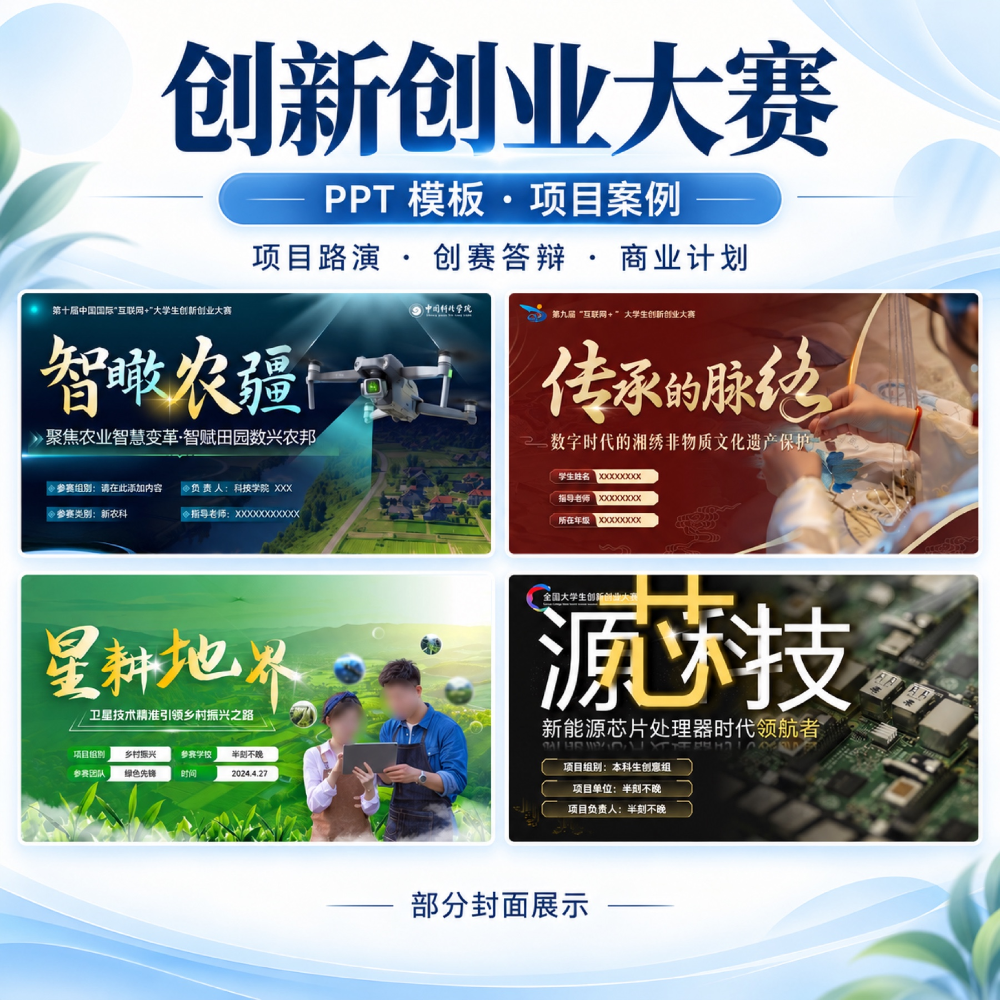
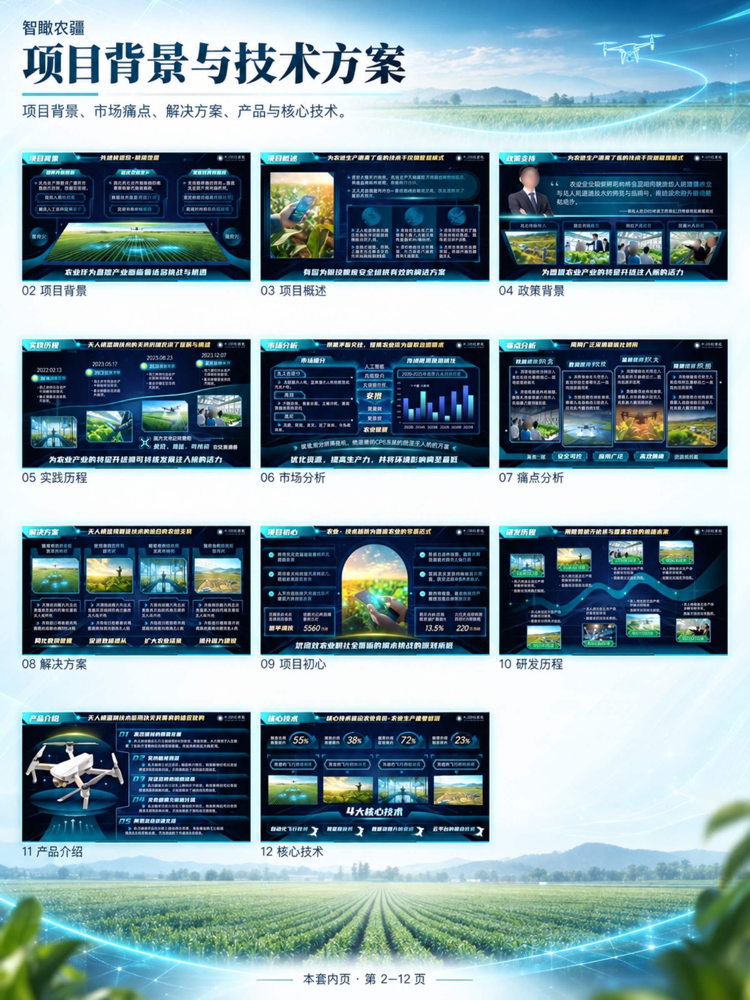
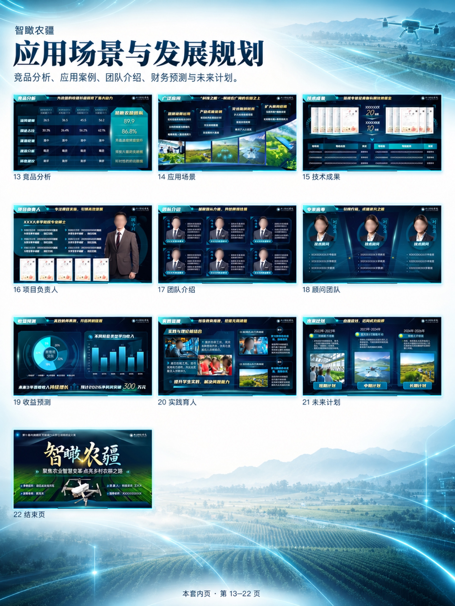
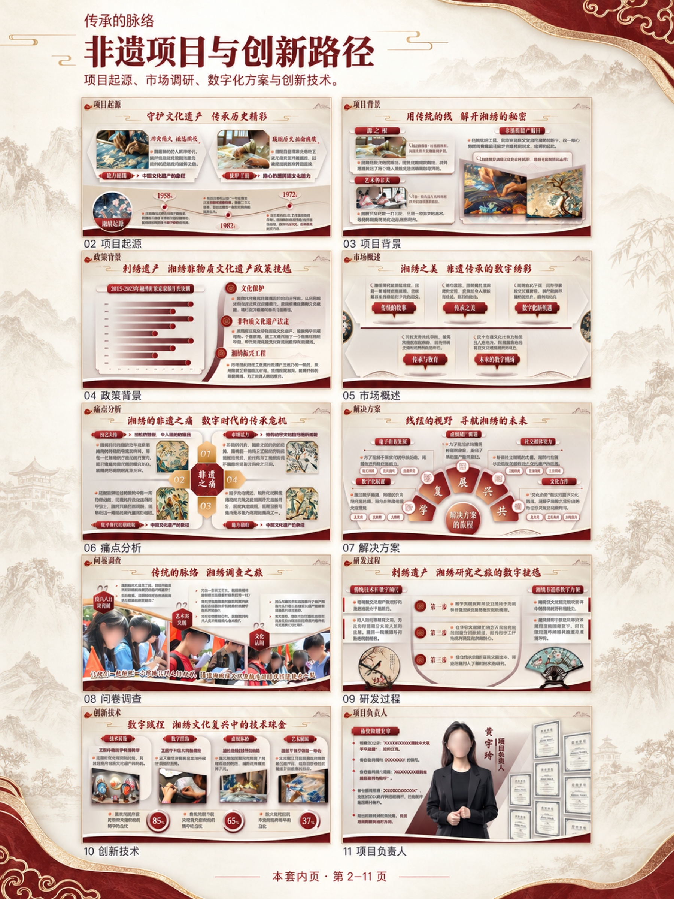
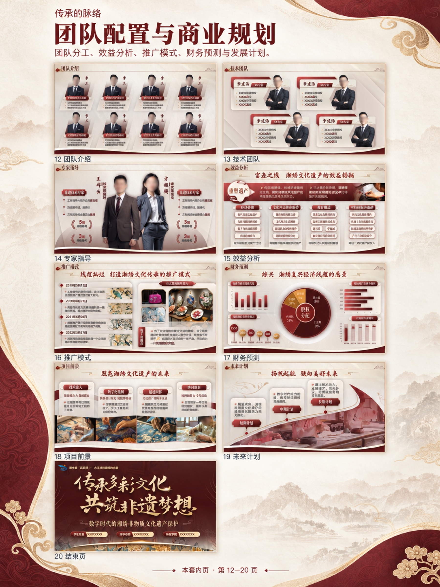
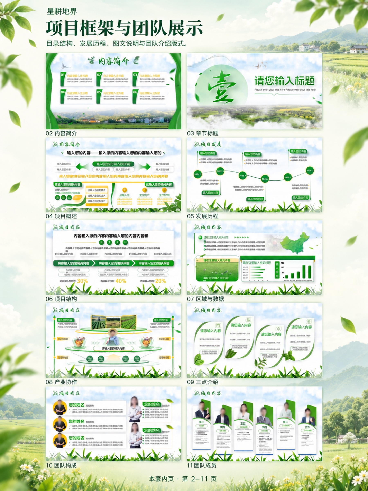
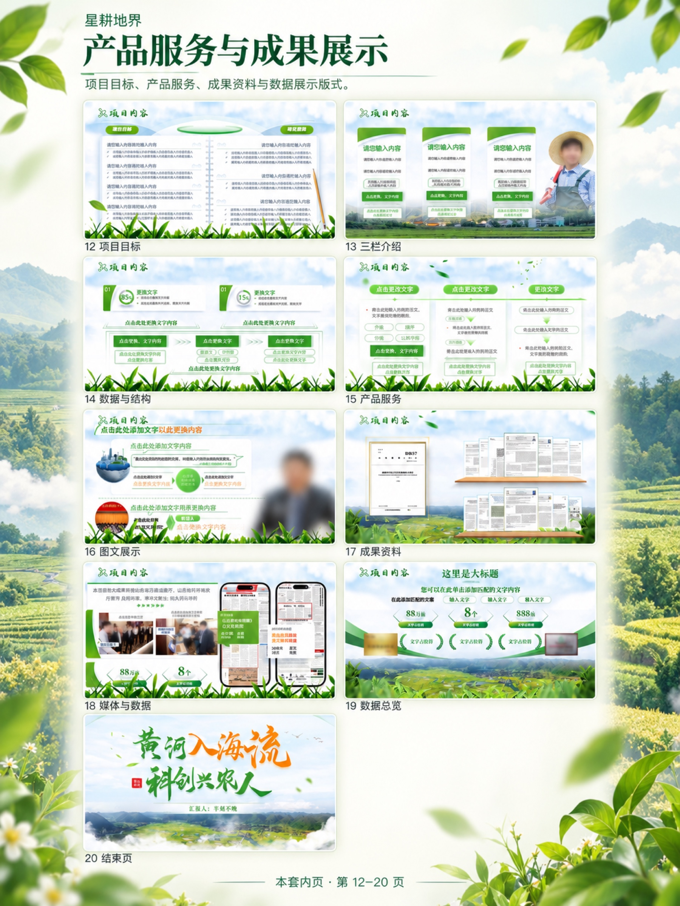
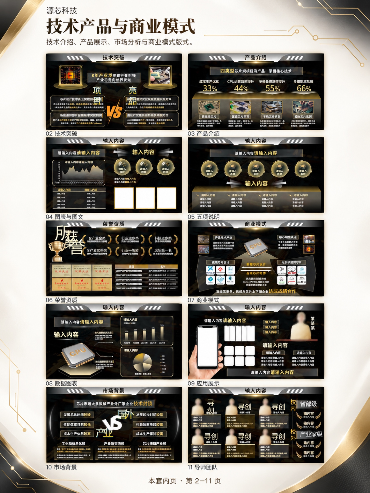
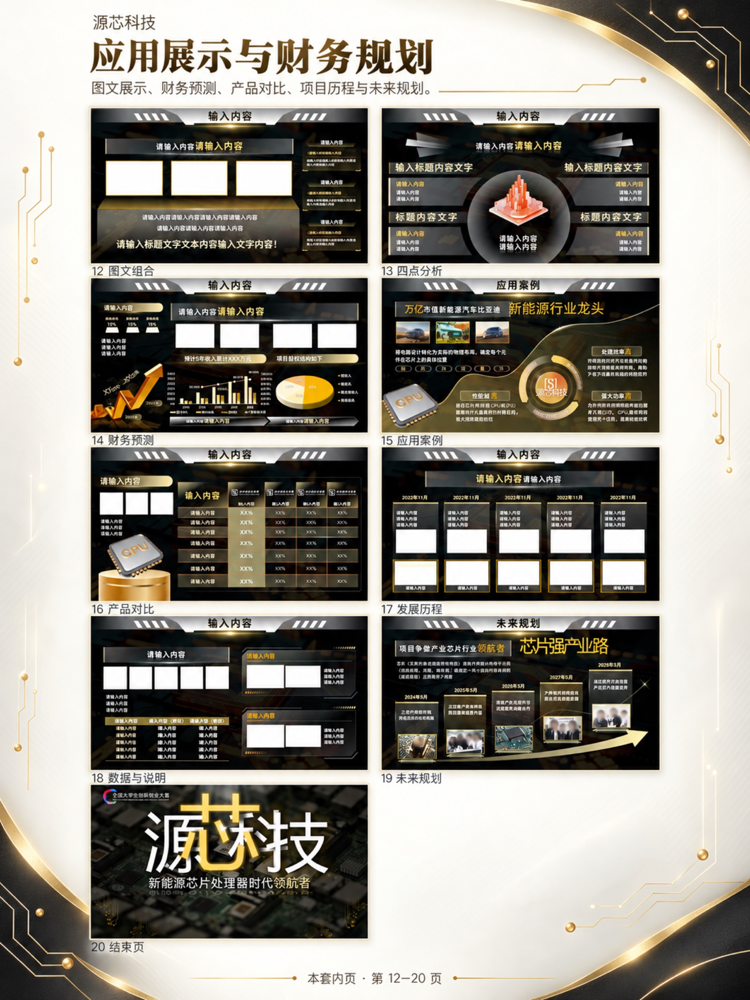

# 创新创业 · 完整九图案例

这组素材已于 2026-10-13 完成。对应本地资料整理口径为 **694 份演示文件**，本次商品图选择 **4 套样例、82 页**，按“集中展示四款封面 → 每套正文连续两张”的顺序组织。

**状态：发布素材已完成；没有闲鱼商品 ID、在线商品链接或已付款订单验证。**

[查看商品文案](listing-copy.txt) · [查看图片尺寸与 SHA-256](manifest.json) · [返回项目首页](../../README.md)

## 九张成品图

以下图片直接复用本项目现有成品 JPG，发布到 GitHub 时未重新生图、裁切或压缩。点击图片可查看大图。

### 01 · 主图

### 02 · 项目背景与技术方案

### 03 · 应用场景与发展规划

### 04 · 非遗项目与创新路径

### 05 · 团队配置与商业规划

### 06 · 项目框架与团队展示

### 07 · 产品服务与成果展示

### 08 · 技术产品与商业模式

### 09 · 应用展示与财务规划

## 样例与原页覆盖

| 样例 | 原始页数 |
| --- | ---: |
| 智瞰农疆 | 22 |
| 传承的脉络 | 20 |
| 星耕地界 | 20 |
| 源芯科技 | 20 |

首图为 1800 × 1800；第 2–9 张为 1800 × 2400。导出分辨率不代表模型原生分辨率。展示图由真实 PPT 选样引导生成，局部小字、人物及图片细节可能与原文件不同；示例内容、人物经历和数值均不构成卖家业绩承诺。

## 文案处理

公开文案保留商品主题、适用场景和内容范围。原草稿中的自动秒发、费用和退款承诺已改为待确认字段，因为目前没有订单履约证据。两款商品价格、类目、实际交付时效和售后约定仍需在平台发布前确定。

完整 PPT 资料、交付网盘链接和提取码不包含在公开仓库中。图片用于展示本项目的制作与整理过程，第三方素材权利不随代码公开而转授，见 [素材与来源说明](../../THIRD_PARTY_NOTICES.md)。
